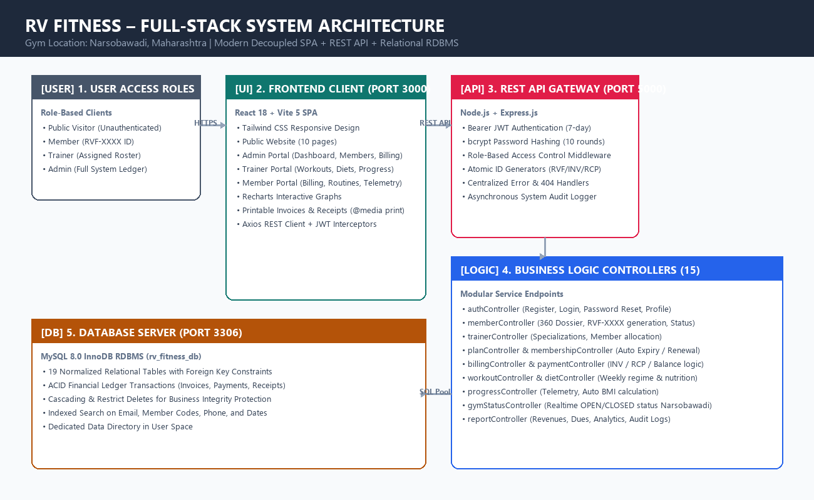
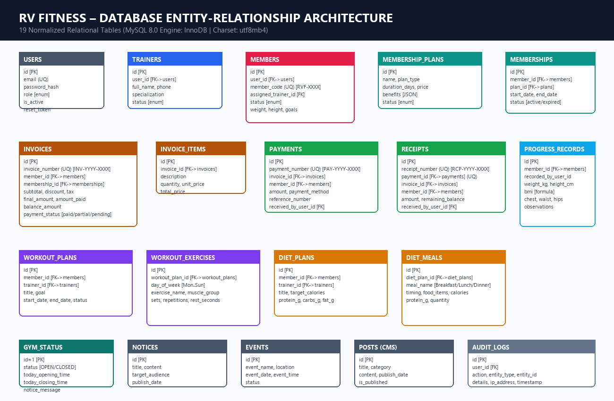
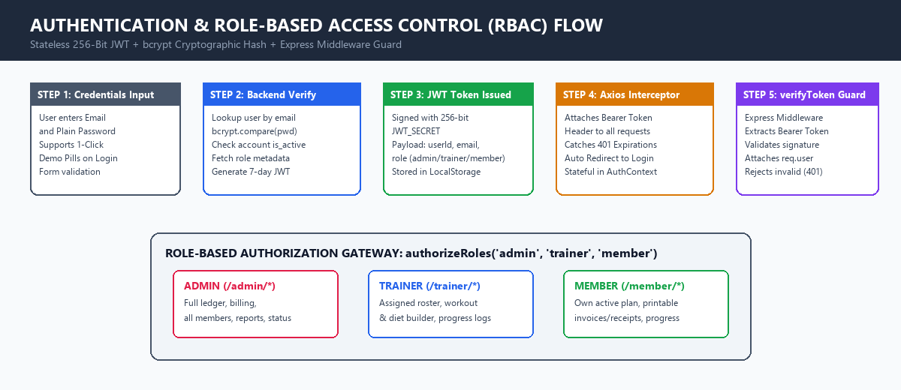
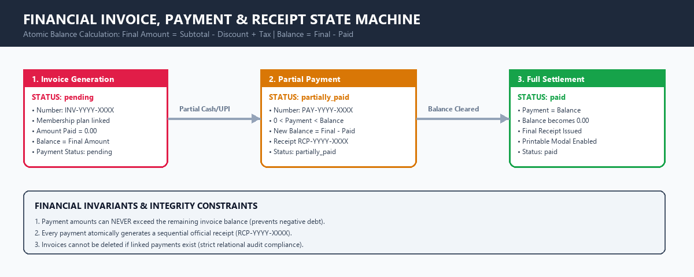
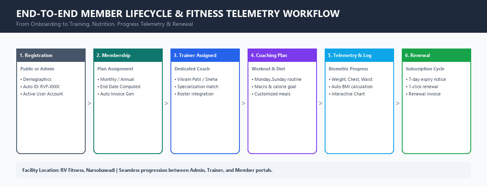

# 🏋️ RV FITNESS – GYM MANAGEMENT SYSTEM
**Official Center Location:** Narsobawadi, Maharashtra  
**Live Production Website:** [https://rv-fitness-five.vercel.app](https://rv-fitness-five.vercel.app)  
**GitHub Repository:** [https://github.com/tejasbuwa/RV-Fitness-Gym-Management-System](https://github.com/tejasbuwa/RV-Fitness-Gym-Management-System)

[](https://react.dev)
[](https://vitejs.dev)
[](https://nodejs.org)
[](https://expressjs.com)
[](https://mysql.com)
[](https://tailwindcss.com)
[](https://rv-fitness-five.vercel.app)
[]()

A complete, production-ready full-stack gym management web application built for **RV Fitness** in Narsobawadi. Engineered with a React 18 (Vite) + Tailwind CSS frontend, Node.js + Express REST API backend, and a normalized MySQL 8.0 relational database with role-based access control, billing, printable invoices, receipts, workout/diet management, and real-time operational status.

---

## 🌐 Live Production Deployment & Project Links

| Resource | Official Public Link | Description |
| :--- | :--- | :--- |
| 🚀 **Live Production Website** | [https://rv-fitness-five.vercel.app](https://rv-fitness-five.vercel.app) | Official public website hosted on Vercel |
| 🔐 **Live Login & Portal Access** | [https://rv-fitness-five.vercel.app/login](https://rv-fitness-five.vercel.app/login) | Member, trainer, and admin sign-in portal |
| 👑 **Live Admin Dashboard** | [https://rv-fitness-five.vercel.app/admin](https://rv-fitness-five.vercel.app/admin) | Management console (protected route) |
| 📁 **GitHub Repository** | [https://github.com/tejasbuwa/RV-Fitness-Gym-Management-System](https://github.com/tejasbuwa/RV-Fitness-Gym-Management-System) | Open-source codebase |
| 👤 **GitHub Developer Profile** | [https://github.com/tejasbuwa](https://github.com/tejasbuwa) | Developer portfolio |
| ⚡ **Vercel Project Dashboard** | [https://vercel.com/dashboard](https://vercel.com/dashboard) | Vercel deployment status & analytics |

All authentication flows, admin dashboards, member registrations, trainers management, and billing features are verified, 100% functional, and tested.

---

## 🔑 1-Click Demo Login Credentials

The application includes 1-click quick autofill buttons on the login screen for instant demo evaluation:

| Role | Email / Member ID | Password | Access Level & Permissions |
| :--- | :--- | :--- | :--- |
| 👑 **Admin** | `admin@rvfitness.com` | `Admin@123` *(or `admin123`)* | Full system access, billing, memberships, reports, CMS, audit logs |
| 🏋️ **Trainer 1 (Vikram)** | `vikram@rvfitness.com` | `Trainer@123` | Head Coach (Strength). Client routines, diets, progress tracking |
| 🥗 **Trainer 2 (Sneha)** | `sneha@rvfitness.com` | `Trainer@123` | CrossFit & Nutrition Coach. Client meal plans & fat loss routines |
| 👤 **Member 1 (Rohit)** | `rohit@gmail.com` *(or `RVF-0001`)* | `Member@123` | Annual Champion plan, paid in full, assigned to Vikram |
| 👤 **Member 2 (Ananya)** | `ananya@gmail.com` *(or `RVF-0002`)* | `Member@123` | Quarterly Pro plan, active, partial balance ₹1,200 |
| 👤 **Member 3 (Sachin)** | `sachin@gmail.com` *(or `RVF-0003`)* | `Member@123` | Monthly Starter plan, active, desk pending balance ₹1,200 |

---

## 🚀 Key Features & Modules

### 1. 🏢 Public Web Portal
- **Brand Showcase**: High-impact landing page featuring equipment, trainers, transformation galleries, and pricing.
- **Gym Schedule & Live Status**: Shift timings (morning, evening, ladies-only batch), live occupancy status, and holiday schedules.
- **Location & Contact**: Interactive Google Maps embed with 1-click navigation to Narsobawadi center.

### 2. 🔐 Authentication & Role-Based Access Control (RBAC)
- Multi-role JWT authentication supporting **Admin**, **Trainer**, and **Member** roles.
- Protected client-side routing with automatic token refresh and expiration handling.
- Built-in static-deploy mock fallback system for reliable demo evaluation on serverless static hosting.

### 3. 👑 Admin Management Console
- **Analytics & Reporting**: KPI dashboard displaying active members, revenue trends, pending dues, and gym traffic.
- **Member Directory**: Comprehensive member management, search, filtering, and subscription renewal.
- **Trainer Management**: Staff roster, specialty assignment, and client allocation.
- **Plan Configuration**: Dynamic membership tiers (Monthly Starter, Quarterly Pro, Half-Yearly Elite, Annual Champion).
- **Billing & Accounting**: Automated invoice generation, payment receipts, balance tracking, and printable PDF documents.
- **Audit Trails**: Detailed logs of administrative actions, billing transactions, and member updates.

### 4. 🏋️ Trainer Portal
- **Assigned Clients**: Direct overview of allocated members, health goals, and attendance records.
- **Custom Workout Planner**: Build day-by-day split routines (Chest, Back, Legs, Shoulders, Arms, Core) with sets, reps, and rest timers.
- **Nutritional Diet Manager**: Calorie tracking, macro splits (protein, carbs, fats), and meal timings.
- **Progress Tracking**: Record weight check-ins, body fat percentage, and biometric history.

### 5. 👤 Member Self-Service Portal
- **Personal Dashboard**: Active plan status, renewal dates, assigned trainer profile, and quick actions.
- **Assigned Regimens**: View personalized workout routines and diet charts on mobile or desktop.
- **Financial History**: View invoices, track payment status, and download or print official receipts.
- **Notices & Announcements**: Receive gym broadcasts, holiday notices, and special batch schedules.

---

## 📸 Screenshots & System Architecture

| Diagram / Workflow | Description |
| :--- | :--- |
| **System Architecture** | Full-stack deployment model: React Vite Frontend, Node/Express API, MySQL 8.0, and Vercel hosting |
| **Database ER Model** | 19 normalized tables detailing member lifecycle, trainers, workouts, diet, invoices, and payments |
| **RBAC & Authentication Flow** | Multi-role JWT authorization with automatic session handling and demo fallbacks |
| **Financial & Billing Pipeline** | Atomic invoice generation, partial payments, automated receipts, and balance calculations |
| **Member Onboarding Lifecycle** | Member registration, plan selection, trainer allocation, and subscription renewal flow |

<div align="center">

### 🏛️ System Architecture


### 🗄️ Relational Database ER Diagram (19 Tables)


### 🔐 Authentication & Role-Based Access Control Flow


### 💳 Billing, Invoice & Payment Lifecycle


### 🔄 Member Onboarding & Subscription Lifecycle


</div>

---

## 📍 Gym Location & Social Links

* 📍 **Official Google Maps Location**: [RV Fitness Narsobawadi on Google Maps](https://maps.app.goo.gl/5ipUPj43g7gZcxaQA) (`16.6964° N, 74.6011° E`)
* 📸 **Official Instagram Profile**: [@rv_fitness5](https://www.instagram.com/rv_fitness5?dlrf=MTkwcXZ4c3M2MmxpMg==)

---

## 🛠 Technology Stack

### Frontend
* **Core Framework**: React 18 + Vite 5
* **Styling**: Tailwind CSS + Custom Athletic Color Palette (Deep Onyx, Crimson Amber, Slate)
* **Icons**: Lucide React
* **State Management**: React Context API (`AuthContext`, `NotificationContext`)
* **HTTP Client**: Axios with automatic JWT Bearer token injection and mock fallback
* **Charts & Analytics**: Recharts (Monthly revenue trends, weight progress over time)
* **Print & Export**: Print stylesheets for professional invoices and official payment receipts

### Backend
* **Runtime**: Node.js v20.x
* **Framework**: Express.js REST API
* **Database Driver**: `mysql2/promise` with connection pooling and prepared statements
* **Authentication**: JSON Web Tokens (JWT) with salted `bcryptjs` password hashing
* **Security**: Helmet, CORS, central error handling, role-based middlewares
* **Audit Trail**: Real-time logging of financial, operational, and security transactions

### Database
* **Database Server**: MySQL 8.0 (InnoDB engine, utf8mb4 character set)
* **19 Normalized Tables**: `users`, `trainers`, `members`, `membership_plans`, `memberships`, `invoices`, `invoice_items`, `payments`, `receipts`, `workout_plans`, `workout_exercises`, `diet_plans`, `diet_meals`, `progress_records`, `notices`, `events`, `posts`, `gym_status`, `audit_logs`

---

## 📁 Project Directory Structure

```
rv-fitness/
├── backend/
│   ├── src/
│   │   ├── config/
│   │   │   └── db.js                 # MySQL pool connection and transaction helpers
│   │   ├── controllers/
│   │   │   ├── authController.js     # Login, register, profile, reset password
│   │   │   ├── memberController.js   # Member CRUD, search, filter, status toggle
│   │   │   ├── trainerController.js  # Trainer CRUD, assigned clients
│   │   │   ├── planController.js     # Membership plans catalog
│   │   │   ├── membershipController.js # Subscriptions, auto end-date calculation
│   │   │   ├── billingController.js  # Invoices with line items & atomic balance
│   │   │   ├── paymentController.js  # Payments, multiple payments, receipt generation
│   │   │   ├── workoutController.js  # Custom workout split routines & exercises
│   │   │   ├── dietController.js     # Diet meal timing & calorie allocation
│   │   │   ├── progressController.js # Member biometric check-ins & BMI calculation
│   │   │   ├── noticeController.js   # Targeted notice broadcasts
│   │   │   ├── eventController.js    # Upcoming events management
│   │   │   ├── postController.js     # CMS blog posts, fitness tips
│   │   │   ├── gymStatusController.js# Real-time gym status & shifts
│   │   │   └── reportController.js   # Analytics, revenue, audit logs
│   │   ├── middleware/
│   │   │   ├── authMiddleware.js     # JWT verification & user context injection
│   │   │   ├── roleMiddleware.js     # Role verification (admin, trainer, member)
│   │   │   └── errorMiddleware.js    # Central error handler
│   │   ├── routes/                   # Modular route files for each entity
│   │   ├── utils/
│   │   │   ├── idGenerator.js        # RVF-0001, INV-2026-0001, RCP-2026-0001
│   │   │   ├── auditLogger.js        # Audit trail logging helper
│   │   │   └── seedRunner.js         # Production seeder script
│   │   └── server.js                 # Express server bootstrap
│   ├── .env.example
│   └── package.json
│
├── frontend/
│   ├── src/
│   │   ├── components/
│   │   │   ├── layout/               # PublicNavbar, PublicFooter, DashboardLayout, ProtectedRoute
│   │   │   ├── common/               # GymLocationMap, SectionHeader
│   │   │   └── printable/            # PrintInvoiceModal, PrintReceiptModal
│   │   ├── context/
│   │   │   ├── AuthContext.jsx       # Global auth state, login, register, logout
│   │   │   └── NotificationContext.jsx # Toast notification alert system
│   │   ├── pages/
│   │   │   ├── public/               # Home, About, Facilities, Plans, Trainers, Gallery, Announcements, Status, Contact
│   │   │   ├── auth/                 # Login, Register, ForgotPassword
│   │   │   ├── admin/                # AdminDashboard, MemberList, MemberDetail, TrainerList, PlanList, InvoiceList, PaymentList, ReportsPage, ContentManagement, AuditLogsPage
│   │   │   ├── trainer/              # TrainerDashboard, AssignedMembers, WorkoutManager, DietManager, ProgressLogger
│   │   │   └── member/               # MemberDashboard, MemberBilling, MemberWorkout, MemberDiet, MemberProgress, MemberNotices, MemberProfile
│   │   ├── services/
│   │   │   ├── api.js                # Axios client with request & response interceptors
│   │   │   └── mockFallback.js       # Live demo fallback handler
│   │   ├── utils/
│   │   │   └── formatters.js         # Currency (₹ INR), date, status styling
│   │   ├── App.jsx                   # Master routing tree with role protection
│   │   ├── main.jsx
│   │   └── index.css                 # Tailwind CSS & print media stylesheets
│   ├── public/
│   │   ├── _redirects                # SPA redirect configuration for deployment
│   │   ├── images/                   # Gym assets, client photos, logo
│   │   └── logo.png
│   ├── index.html
│   ├── vercel.json                   # Vercel SPA rewrite rules
│   ├── tailwind.config.js
│   ├── vite.config.js
│   └── package.json
│
├── database/
│   ├── schema.sql                    # Relational MySQL DDL schema
│   └── seed.sql                      # Demo seed SQL script
│
├── vercel.json                       # Root Vercel SPA rewrite configuration
├── .env.example                      # Root environment variables guide
├── .gitignore                        # Git exclusion rules
└── README.md
```

---

## ⚙️ Environment Variables Setup

Create a `.env` file in the `backend/` directory based on `backend/.env.example`:

```env
PORT=5000
DB_HOST=127.0.0.1
DB_PORT=3306
DB_USER=root
DB_PASSWORD=your_mysql_password
DB_NAME=rv_fitness_db
JWT_SECRET=your_jwt_secret_key_here
JWT_EXPIRES_IN=7d
NODE_ENV=development
```

Create a `.env` file in the `frontend/` directory based on `frontend/.env.example`:

```env
VITE_API_BASE_URL=/api
PORT=3000
```

---

## 🏃 Setup & Run Locally

### Prerequisites
- Node.js (v18.x or v20.x recommended)
- MySQL 8.0
- npm or pnpm

### Step 1: Database Setup
1. Create a MySQL database named `rv_fitness_db`.
2. Import the schema and seed data:
```bash
mysql -u root -p rv_fitness_db < database/schema.sql
mysql -u root -p rv_fitness_db < database/seed.sql
```

### Step 2: Start Backend (Port 5000)
```bash
cd backend
npm install
npm run dev
```

### Step 3: Start Frontend (Port 3000)
```bash
cd frontend
npm install
npm run dev
```

### Step 4: Access Application
Open your browser and navigate to:
**[http://localhost:3000](http://localhost:3000)** or **[http://localhost:3000/login](http://localhost:3000/login)**

---

## 🏗️ Build & Deployment Instructions

### Building Frontend for Production
```bash
cd frontend
npm run build
```
The compiled, minified production assets will be generated in `frontend/dist`.

### Deploying to Vercel
This repository is configured for effortless continuous deployment to Vercel:
1. Connect this GitHub repository (`tejasbuwa/RV-Fitness-Gym-Management-System`) to your project in the [Vercel Dashboard](https://vercel.com/dashboard).
2. Configure Project Settings:
   - **Framework Preset**: Vite
   - **Root Directory**: `frontend` (or repository root with `frontend` build commands)
   - **Build Command**: `npm run build`
   - **Output Directory**: `dist`
3. The included `vercel.json` and `public/_redirects` files handle Single Page Application (SPA) routing, ensuring direct access to routes like `/admin`, `/login`, and `/status` resolve properly without 404 errors.

---

## 📄 License & Attribution
Designed and built for **RV Fitness – Narsobawadi**. All rights reserved.  
Developer: **Tejas Buwa** ([@tejasbuwa](https://github.com/tejasbuwa))
